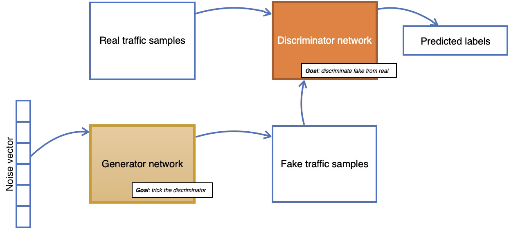

# Generative Adversarial Networks (GANs)
A GAN is a machine learning model that consists of two neural networks, the generator and the discriminator, which compete with each other using deep learning methods to become more accurate in their predictions.

|   |
|--|
| Architecture of a GAN|

In this [notebook](GAN_Flatten.ipynb), we will implement and train a GAN for data augmentation. The objective is to train a generator that can generate realistic samples of benign network traffic.