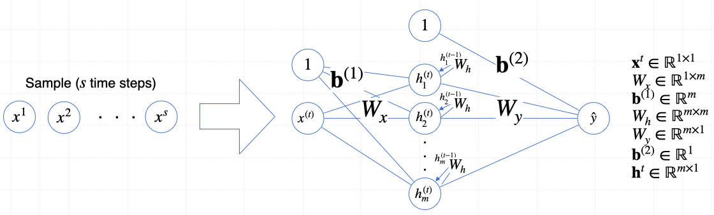

# Anomaly detection with Recurrent Neural Networks
In this [notebook](RNN.ipynb), we will implement a basic RNN for anomaly detection. The RNN consists of a single recurrent layer and is trained to predict the next value of a time series. 

|   |
| -- |
| A simple RNN with ```m``` hidden neurons. |

If the RNN is trained with normal data, it will be able to predict the next normal value of a time series. When used to detect anomalies, this prediction can be compared with the actual `next value` to determine whether it is normal or not.