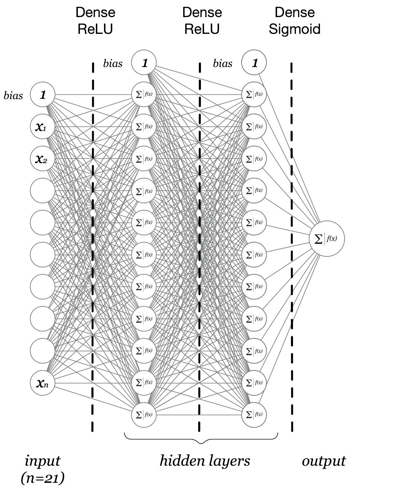

# Adversarial Machine Learning attack against a DL-based NIDS
In this experiment, our primary focus is to assess the robustness of DL-based NIDSs against evasion attacks using AML. Specifically, we evaluate an MLP-based NIDS under two conditions: (1) unperturbed attack and benign network traffic, and (2) manipulated network traffic.

The objective of this study is to analyze how network traffic manipulation impacts the accuracy of the NIDS and to explore how attackers can exploit weaknesses in NIDSs to execute successful attacks.

The model is designed for binary classification of the network traffic as benign or malicious. Therefore, it returns a value between 0 and 1, which is the probability of the input flow of being malicious. 


|   |
|--|
| Sample MLP architecture|


The laboratory is divided into two phases:
-  **Phase 1**: MLP-based NIDS
    - train a pre-defined MLP model and test it using the test set and an unperturbed traffic trace [ddos-chunk-short.pcap](./DOS2019_Binary_5_Attacks_PCAPs/ddos-chunk-short.pcap)
    - ensure that the model achieves a high accuracy on the test set and that it correctly classifies the unperturbed attack traffic trace as malicious
    - if not, you can modify the model architecture and/or hyperparameters to improve the accuracy of the model on the test set and the unperturbed attack traffic trace
    - change the ```train``` and ```predict``` functions in the notebook to make them accept the dataset path and model path as arguments
    - convert the notebook into a Python script using the command ```jupyter nbconvert --to script NIDS_AML.ipynb```
-  **Phase 2**: Live AML attack  
    - run the NIDS in a separate terminal using the command ```python NIDS_AML.py --predict_live ./DOS2019_Binary_5_Attacks_PCAPs/ddos-chunk-short.pcap --model ./MLP_model.keras```. This verifies that the model correctly classifies the unperturbed attack traffic trace as malicious.
    - perturb the original traffic using the [aml-attack.py](./aml-attack.py) script, which adds one or more perturabations to the packets among the following:
        - Random TCP Window size (--min-tcp-window --max-tcp-window) using values between 0 and 65535
        - Random IAT perturbation (--min-delay-ms --max-delay-ms) using values between 1 and 1000 milliseconds
        - Random packet length change (--min-length-change --max-length-change) using values between 0 and 1500 bytes
        - Random TTL change (--min-ttl --max-ttl) using values between 0 and 255
        - IP fragmentation flags (--perturb-ip-flags)
    - Example command to perturb the IP flags::
    ```python aml-attack.py DOS2019_Binary_5_Attacks_PCAPs/ddos-chunk-short.pcap -o  DOS2019_Binary_5_Attacks_PCAPs/ddos-chunk-short-aml.pcap --perturb-ip-flags```
    - Finally run the NIDS in a separate terminal using the command ```python NIDS_AML.py --predict_live ./DOS2019_Binary_5_Attacks_PCAPs/ddos-chunk-short-aml.pcap --model ./MLP_model.keras```. This verifies that the model misclassifies the perturbed attack traffic trace as benign.

## Dataset
You will use a dataset of benign and various DDoS attacks from the CIC-DDoS2019 dataset (https://www.unb.ca/cic/datasets/ddos-2019.html).
The network traffic has been previously pre-processed in a way that packets are grouped in bi-directional traffic flows using the 5-tuple (source IP, destination IP, source Port, destination Port, protocol). Each flow is represented with 21 packet-header features computed from max 1000 packets:

| Feature nr.         | Feature Name |
|---------------------|---------------------|
| 00 | timestamp (mean IAT) | 
| 01 | packet_length (mean)| 
| 02 | IP_ttl (mean) |
| 03 | IP_flags_df (sum) |
| 04 | IP_flags_mf (sum) |
| 05 | IP_flags_rb (sum) | 
| 06 | IP_frag_off (sum) |
| 07 | TCP_length (mean) |
| 08 | TCP_flags_ack (sum) |
| 09 | TCP_flags_cwr (sum) |
| 10 | TCP_flags_ece (sum) |
| 11 | TCP_flags_fin (sum) |
| 12 | TCP_flags_push (sum) |
| 13 | TCP_flags_reset (sum) |
| 14 | TCP_flags_syn (sum) |
| 15 | TCP_flags_urg (sum) |
| 16 | TCP_window_size (mean) |
| 17 | UDP_length (mean) |
| 18 | ICMP_type (mean) |
| 19 | ICMP_code (mean) |
| 20 | Packets (counter)|