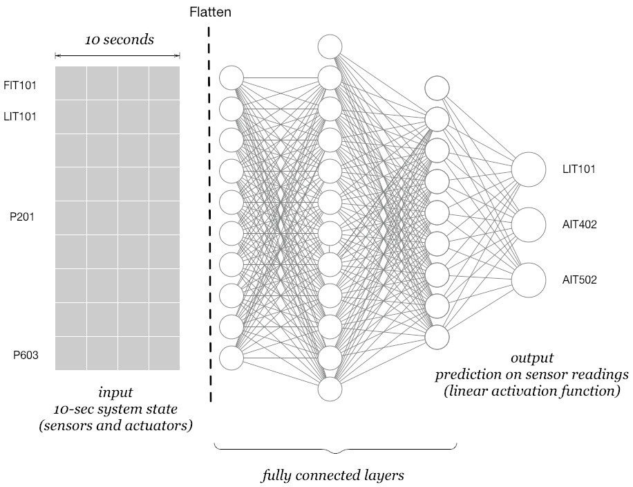

# Anomaly Detection in Industrial Control Systems
In this demo, we analyse the challenges related to anomaly detection in Industrial Control Systems (ICSs). The anomaly detection system is based on a neural network trained on the normal behaviour of the ICS, with the aim to spot anomalies when the actual behaviour diverge from the network's predictions.
The model’s input comprises sensor readings and actuator states collected over the past 10 seconds. Its output is a prediction of the readings for three sensors for the next second. The mean squared error (MSE) between the predicted and actual sensor readings is used to identify potential anomalies in the system.

|   |
|--|
| NN model for anomaly detection|

For the demo, we will rely on the SWaT dataset (https://itrust.sutd.edu.sg/itrust-labs_datasets/dataset_info/) to show the problem of predicting the readings of sensors whose normal behaviour changes over the time.